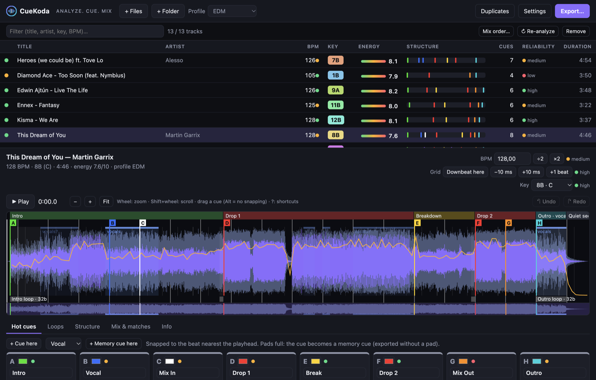
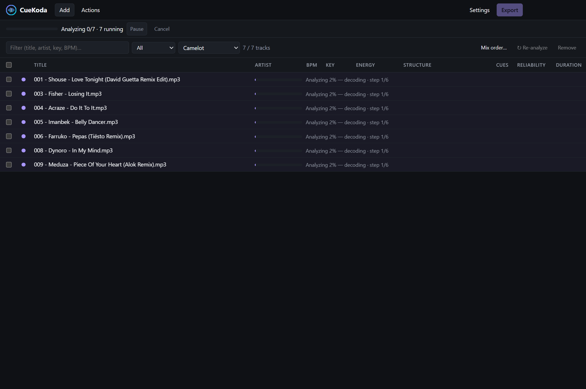
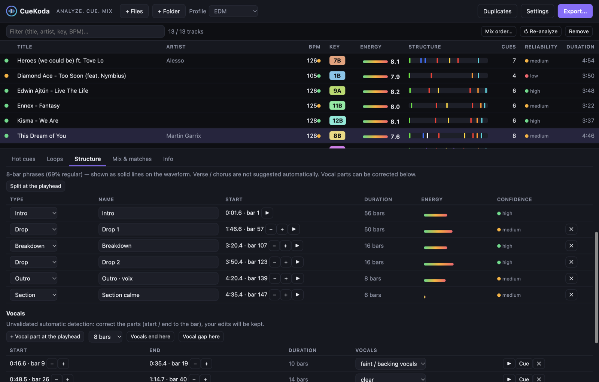
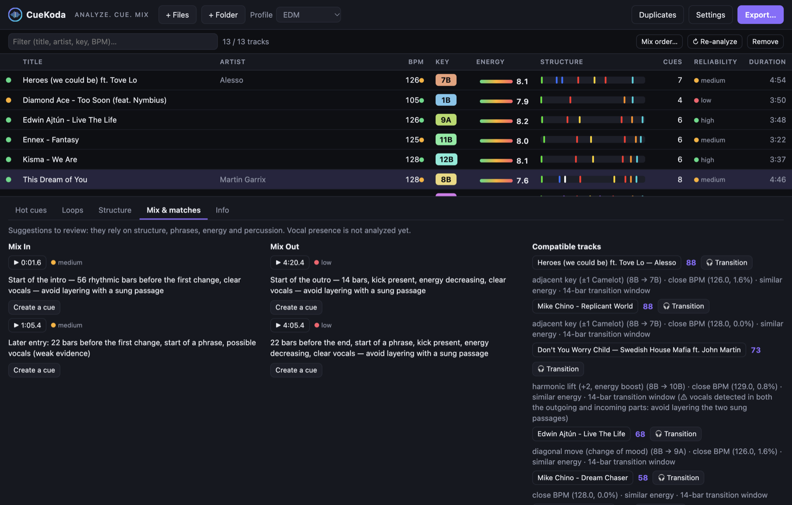
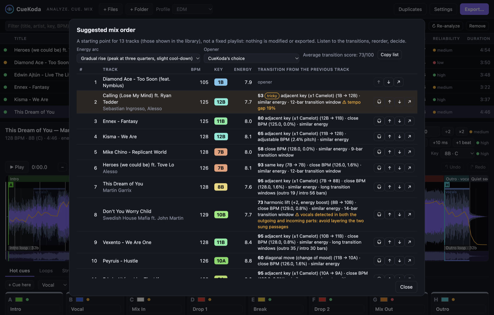
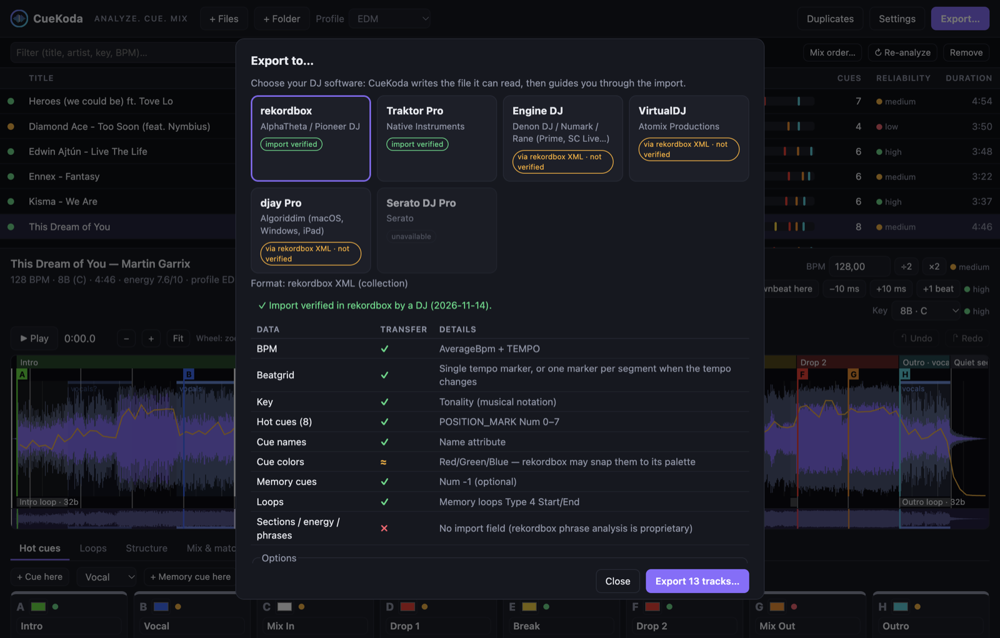
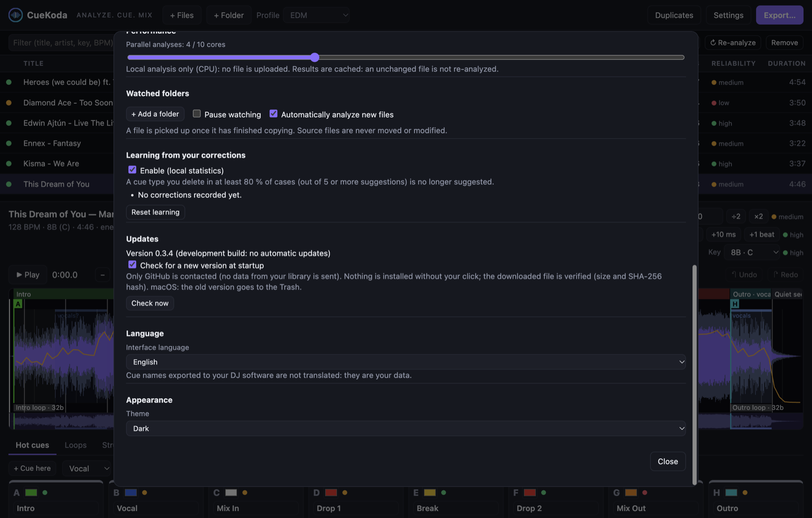

<p align="center">
  <picture>
    <source media="(prefers-color-scheme: dark)" srcset="assets/logo/png/cuekoda-logo-sombre@2x.png">
    
  </picture>
</p>

<p align="center">
  <b>Your track prep, done for you. The decisions stay yours.</b><br>
  BPM · beatgrid · Camelot key · structure · energy · hot cues · loops → rekordbox, Traktor and more
</p>

<p align="center">
  <a href="https://github.com/Hadr1en/cuekoda/releases/latest"></a>
  
  <a href="LICENSE"></a>
  
  <a href="README.md"></a>
</p>

<p align="center">
  
</p>

CueKoda is a **track-preparation app for DJs** (macOS and Windows). It is not mixing software. You give it
audio files, it analyses them, and you get back annotated tracks to import into **rekordbox, Traktor,
Engine DJ, VirtualDJ or djay Pro**. It is built with EDM in mind (house, big room, progressive, techno,
trance…) but also works for open-format sets.

## Contents
- [Principles](#principles)
- [Download and install](#download-and-install)
- [Get started in 4 steps](#get-started-in-4-steps)
- [Features in detail](#features-in-detail)
  - [Analysis](#1-analysis) · [Hot cues and memory cues](#2-hot-cues-and-memory-cues) ·
    [Structure and vocals](#3-structure-and-vocals) · [Loops](#4-loops) · [Mixing and transitions](#5-mixing-and-transitions) ·
    [Mix order](#6-suggested-mix-order) · [Library](#7-library) · [Export](#8-export-to-your-dj-software) ·
    [Settings, updates, language](#9-settings-updates-and-language)
- [Reliability and limits](#reliability-and-limits)
- [Keyboard shortcuts](#keyboard-shortcuts)
- [Privacy and safety](#privacy-and-safety)
- [For developers](#for-developers)

## Principles
- **CueKoda prepares, the DJ decides.** Every suggestion shows its confidence (high / medium / low) and why
  it was made. You can change all of it.
- **Your corrections are kept.** Cues you moved, renamed or locked, sections you fixed, vocal parts you
  adjusted: all of it survives re-analysis.
- **Nothing leaves your computer.** Analysis is 100% local. Audio files are never uploaded, modified, moved
  or deleted.
- **No false precision.** Anything unverified is labelled as such: an export "not checked yet", vocal
  detection "experimental", a key "ambiguous", a downbeat "uncertain".

## Download and install
Installers are rebuilt on every code update and published in the
[**Releases**](https://github.com/Hadr1en/cuekoda/releases/latest).

| System | File |
|---|---|
| macOS 13+ Apple Silicon (M1 to M4) | `CueKoda-<version>-mac-arm64.dmg` |
| macOS 13+ Intel | `CueKoda-<version>-mac-x64.dmg` |
| Windows 10 / 11 64-bit | `CueKoda-<version>-windows-setup.exe` |

**First launch:** the app is not signed by Apple or Microsoft yet.
- **macOS**: drag CueKoda to Applications, open it once, then System Settings › Privacy & Security ›
  **Open Anyway**.
- **Windows**: at the SmartScreen warning, **More info** › **Run anyway**.

**Updates** — CueKoda checks public GitHub releases. You can also download the installer from Releases
and install it manually.

## Get started in 4 steps
1. **Import**: drop files or a folder onto the window, or use "+ Files" / "+ Folder". Formats: MP3, WAV,
   AIFF, FLAC, M4A / AAC, OGG, Opus, WMA.
2. **Analyse**: analysis starts on its own, several tracks at a time. Each row shows the current stage and
   percentage.
3. **Check and correct**: click a track, listen, drag cues on the waveform, fix BPM, grid or key if needed.
   The **Reliability** column tells you what to check first.
4. **Export**: "Export…", pick your software, save the file, follow the import steps shown.

## Features in detail

### 1. Analysis


| Data | What CueKoda does |
|---|---|
| **BPM** | Estimate, half / double time chosen from the profile's BPM range, stability, confidence. Manual correction, ÷2 and ×2. |
| **Beatgrid and downbeat** | Phase locked to about 2 ms on the attacks. The downbeat is voted from section changes and from **kick / bass entries**, and marked "uncertain" when the vote is close. Corrections: "Downbeat here", ±10 ms, +1 beat. |
| **Variable tempo** | Detects tempo changes and builds a tempo map (one marker per range), exported to rekordbox. |
| **Key** | Musical notation, **Camelot** and Open Key. A second pass flags ambiguous keys and lists alternatives. Detected key changes appear in Info. |
| **Loudness** | Integrated LUFS, loudness range, true peak, RMS, peak (ffmpeg `ebur128`). |
| **Energy** | 1–10 score and a per-bar curve (loudness normalised by integrated LUFS, attack density, low end, brightness). |
| **Structure** | Intro, build-up, drop, breakdown, outro, 8 / 16 / 32-bar phrases (only when they are regular). **Drops** are found from energy tiers and placed on the bass entry. |
| **Vocals** | Experimental local detection (MusiCNN model + heuristic): clear or faint vocal parts. |
| **Fingerprint** | Per-bar chroma fingerprint, used to spot duplicates and versions of the same track. |

The analysis queue can be paused, cancelled and retried, and respects a CPU limit. A broken file never
blocks the others. A track that was already analysed and has not changed comes back instantly from the cache.

### 2. Hot cues and memory cues
The cues in the top screenshot are placed from the music: Intro, Vocal, Build, Drop 1, Break, Drop 2,
Mix In / Mix Out, Outro… Each has a **colour per function** (customisable per profile), a **confidence
level** and a **reason** ("bass entry: +12 dB in the low end").

- **Drag** a flag on the waveform to move a cue (snaps to the beat, Alt = free).
- ±1 beat / ±1 bar buttons, rename, recolour, 🔒 lock, ✕ delete.
- **"+ Cue here"** adds a cue of the chosen type (Vocal by default, for when the vocal comes back) on the
  first free pad. When all 8 pads are taken, it becomes a **memory cue**.
- **Memory cues**: cues without a pad, listed under the pads, which you can move onto a pad at any time.
  They export as rekordbox memory cues and Traktor stored cues.
- **Vocal cues** — Built-in profiles exclude Vocal suggestions. Enable them in a custom profile or add a
  Vocal cue manually.
- **Overlapping cues** — You can only add a cue at a free position. Moving a cue onto another cue flags
  the duplicate on the pads and in the export preview.
- Undo / redo (⌘Z / ⇧⌘Z). Sections follow the Intro / Build / Drop / Break / Outro cues you move.
- **Learning**: a cue type you almost always delete is no longer suggested (local statistics, can be reset).

### 3. Structure and vocals


- **Sections**: change type and name, move the start to the bar, split at the playhead, merge. The coloured
  band on the waveform updates.
- **Vocals**: add a part at the playhead, move its start and end, "Vocal ends here", "Vocal pause here",
  mark it clear or faint, create a Vocal cue in one click. Your vocal parts replace automatic detection on
  every re-analysis.

### 4. Loops
Suggested loops (intro, outro, pre-drop, breakdown start), 4 to 64 beats long, with looped preview and
approval. Only approved loops are exported by default. Key **L**: 16-beat loop at the playhead.

### 5. Mixing and transitions


- **Mix In / Mix Out**: explained entry and exit points (phrases, percussion, energy, vocals), turned into a
  cue in one click.
- **Compatible tracks**: key (same, adjacent, relative, energy boost…), BPM gap (half / double time
  included), energy, length of the transition windows. Each match is scored and explained, with warnings
  (two sung parts overlapping, uncertain key…).
- **🎧 Transition**: plays the end of the current track into the start of the other one. The tempo is
  matched without changing the key, beats are aligned on Mix Out / Mix In, and the crossfade lasts 16 bars.
  Beyond a ±8% tempo gap CueKoda refuses rather than mangling the sound.

### 6. Suggested mix order


A low-key "Mix order…" button above the list suggests an order for the tracks shown. Filter first to work
on a selection. Nothing is applied or exported: it is a starting point, and **building the set stays your
job**.

- **Energy arc**: gradual rise (peak at three quarters, then a slight cool-down), waves, or free (key and
  tempo only).
- **Opener**: let CueKoda choose, or pick your first track.
- Each transition is **scored out of 100 and explained**. **Hard** transitions (clashing keys, tempo gap
  > 8%) are highlighted.
- Move tracks up / down, listen to each transition (🎧), open a track, **copy the list**.
- **Export this set…**: the list goes to your DJ software as a named playlist, in your order.

### 7. Library
- Sortable, filterable list (title, artist, key, BPM) with Camelot key colours, energy, a cue thumbnail and
  reliability.
- **Watched folders**: a file copied into a watched folder is analysed automatically once the copy has
  finished.
- **Duplicates**: exact duplicates, the same recording in another format, related versions (remix, edit),
  found with the acoustic fingerprint. Nothing is deleted; you decide.
- **DJ profiles**: EDM, House, Tech House, Techno, Trance, Hip-Hop, Open Format, or your own (BPM range,
  cues to place, colours, loops).
- **EDM — fixed pads** assigns pads A through H to Intro, Build 1, Drop 1, Break, Build 2, Drop 2,
  Outro and Mix Out. If a cue is missing, its pad stays free.
- **Review** — Use “To review” to find tracks worth checking and “Missing files” to see unavailable
  paths. Mark tracks as checked after listening.
- **References**: "Validate as reference" saves a track you checked by ear. References measure the
  engine's accuracy (`npm run eval`).

### 8. Export to your DJ software


A single **"Export…"** button. Pick your software, see what will and will not be transferred, save the file,
then follow the import steps.

| Software | File written | BPM / grid / key | Hot cues, names | Colours | Memory cues | Loops | Import |
|---|---|---|---|---|---|---|---|
| **rekordbox** | rekordbox XML | ✓ (multi-tempo grid) | ✓ | ✓ | ✓ | ✓ | ✅ checked |
| **Traktor Pro** | Traktor NML | ✓ (single tempo) | ✓ | — (colour by type) | ✓ (padless cues) | ✓ | ✅ checked |
| **Engine DJ** (Denon, Numark, Rane) | rekordbox XML | depends on Engine DJ | depends on Engine DJ | ? | ? | ? | to be checked |
| **VirtualDJ** | rekordbox XML | depends on VirtualDJ | depends on VirtualDJ | ? | ? | ? | to be checked |
| **djay Pro** | rekordbox XML | depends on djay | depends on djay | ? | ? | ? | to be checked |
| **Serato DJ Pro** | — | — | — | — | — | — | unavailable |

**Useful options**:
- **"E8 · 8B · Vocal" comment** (on by default): energy, Camelot key and vocals written to the Comments field,
  so you can sort and filter your collection right in your DJ software. "Vocal" or "Instru" is only written on
  clear evidence.
- **Export a set**: from "Mix order…", "Export this set…" creates a named playlist with the tracks in the order
  you arranged.

Serato stores its cues **inside the audio files themselves**. Writing them would modify your files, which
CueKoda never does. Details and the checking procedure: [export matrix](docs/MATRICE_EXPORT.md) (French).

In Traktor, AutoGrid occupies button 1. Pads A–G map to buttons 2–8, and pad H becomes a stored cue.
The generated NML is covered by automated tests. The mapping still needs checking in Traktor Pro.

Use **“Import collection…”** to bring a rekordbox XML or Traktor NML collection into CueKoda. Imported
cues are locked and suggestions fill free pads. You can also adopt the BPM and first grid marker.
See the [export and import matrix](docs/MATRICE_EXPORT.md) (French).

Export safety: CueKoda writes a **new collection file** and never touches your DJ software's database
(`master.db`, `collection.nml`). An existing file is backed up first.

### 9. Settings, updates and language


- **Updates** — The optional start-up check and “Check now” use public GitHub releases without sending
  library data. Installation requires a click and a file matching both the expected size and a valid
  SHA-256 digest. The digest checks download integrity. See [distribution decisions](docs/DISTRIBUTION.md) (French).
  - **Windows**: silent install, then restart.
  - **macOS**: the old version goes to the Trash, the new one takes its place and restarts.
- **Language**: French or English. Your cue names are never translated; they are your data.
- **Theme**: dark (default), light or system. Also: number of parallel analyses, watched folders, learning,
  profiles.

## Reliability and limits
CueKoda is upfront about what it can do:
- **DJ checks** — An export was imported into rekordbox and Traktor. The
  [evaluation report](docs/EVALUATION.md) measures cue accuracy on three EDM tracks corrected by ear.
- **Still to confirm** — The new Traktor mapping, import offsets by audio format, Engine DJ, VirtualDJ
  and djay Pro imports, Windows updates and energy calibration.
- **Experimental**: vocal detection (some vocals may be missed). Verse / chorus is only suggested on strong
  evidence.
- **Not done yet**: stem separation.
- **Variable tempo**: markers are exported to rekordbox, but cues and sections use the average grid, and
  Traktor receives a single tempo.

Feature-by-feature status: [feature status](docs/AUDIT_ET_PLAN.md); how the algorithms work:
[ALGORITHMES.md](docs/ALGORITHMES.md) (both in French).

## Keyboard shortcuts
| Key | Action |
|---|---|
| Space | Play / pause |
| ← / → | One bar back / forward (Shift: one beat) |
| ↑ / ↓ | Previous / next track |
| 1 … 8 | Jump to hot cue A … H |
| Shift + 1 … 8 | Set hot cue A … H at the playhead |
| C / M | Add a cue (first free pad, else memory cue) / a memory cue |
| , / . | Move the selected cue by one beat (Shift: one bar) |
| Delete | Delete the selected cue |
| L | 16-beat loop at the playhead |
| + / − / 0 | Zoom in / out / whole track |
| ⌘Z / ⇧⌘Z | Undo / redo |
| ⌘E | Export |
| ⌘ / Ctrl + F | Filter the library |
| ? | Help |

## Privacy and safety
- Local analysis: no file and no library data is ever sent online.
- The only network connection is the update check on GitHub, which you can turn off.
- Audio files are never modified, moved or deleted. Duplicates are flagged, never removed.
- Exports write a new file and back up the old one; your DJ software's database is never modified directly.

## For developers

```bash
npm install
```

```bash
npm start
```

| Command | Purpose |
|---|---|
| `npm run test:all` | Typecheck, unit tests, end-to-end test on synthetic tracks |
| `npm run test:regression` | Re-analyses `samples/` and compares with `tests/baselines/samples.json` |
| `npm run smoke` | Starts the real Electron app (hidden window) and drives the UI |
| `npm run eval` | Measures engine accuracy on the tracks you validated as references |
| `npm run eval:dj` | Evaluates the DJ corrections on three tracks supplied locally in `samples/` |
| `npm run offset-test` | Generates click tracks and XML/NML collections for measuring import offsets |
| `npm run dist:mac` / `dist:win` | Builds the installers locally |

The command line uses the same engine:

```bash
npm run build && node dist/cli/cli.js ~/Music/MyFolder --profile house --out output
```

**Architecture**
```
src/core/       pure engine: decoding, tempo, grid, key, energy, structure, cues, loops, mix, profiles,
                merge, matching, mix order, transitions, duplicates, learning, export/
src/main/       Electron: persistent library, cache, analysis queue (workers), watched folders, updater
src/renderer/   UI (library, analysis view, dialogs): plain HTML / CSS / TypeScript, no framework
src/shared/     IPC types, update logic, translation
src/test/       unit, end-to-end, regression, diagnostics
```

**Stack and third-party licences**: Electron 45, TypeScript, esbuild, electron-builder; Essentia.js
(AGPL-3.0), ffmpeg-static (GPL binary), music-metadata, TensorFlow.js (Apache-2.0) and the
`voice_instrumental-musicnn-msd-2` model from the Music Technology Group (UPF). See the [licence](#licence).

## Licence
CueKoda is free software under the **GNU AGPL v3 or later** ([LICENSE](LICENSE)): you may use, study, modify
and redistribute it, provided you also publish the source code of your modified versions, including when
they are offered as an online service. Copyright © 2026 Hadr1en.

Third-party components, each under its own licence: Essentia.js (AGPL-3.0), ffmpeg-static (GPL binary),
TensorFlow.js (Apache-2.0), music-metadata (MIT) and Electron (MIT). The `voice_instrumental-musicnn-msd-2` vocal model from
the Music Technology Group (UPF) has its own terms, including a noncommercial clause.
See the [note on the model licence](docs/DISTRIBUTION.md#décisions-avant-diffusion) (French).

## Logo
The *coda* ring ("Koda") holds a waveform whose white centre bar marks the cue point. Sources in
[assets/logo](assets/logo).
