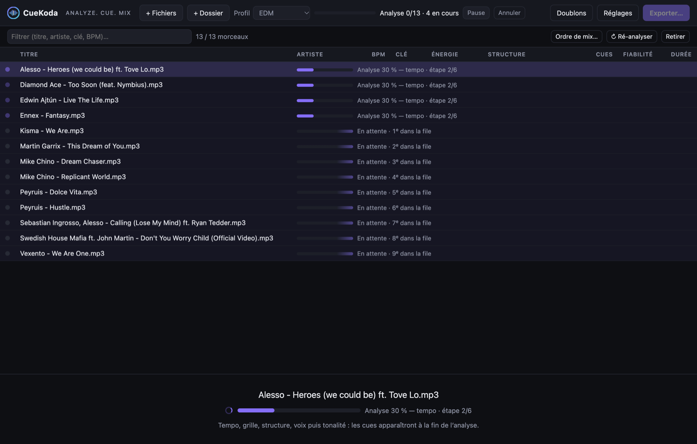
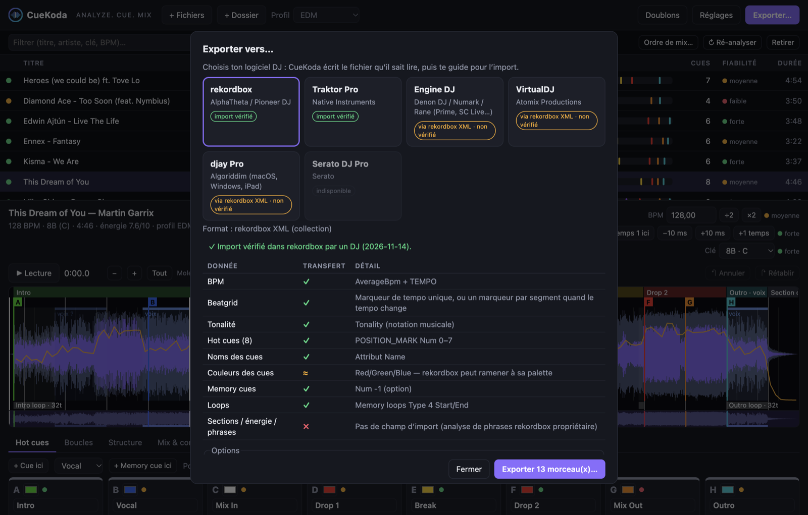

<p align="center">
  <picture>
    <source media="(prefers-color-scheme: dark)" srcset="assets/logo/png/cuekoda-logo-sombre@2x.png">
    
  </picture>
</p>

<p align="center">
  <b>Analyse locale, préparation des pistes et export vers les logiciels DJ.</b><br>
  <a href="https://hadr1en.github.io/cuekoda/">Site officiel</a> · <a href="docs/GUIDE_UTILISATEUR.md">Guide utilisateur</a>
</p>

<p align="center">
  <a href="https://github.com/Hadr1en/cuekoda/releases/latest"></a>
  
  <a href="LICENSE"></a>
  
  <a href="README.en.md"></a>
</p>

<p align="center">
  
</p>

CueKoda est une application **de préparation musicale pour DJ** sur macOS et Windows. Elle analyse les fichiers audio, propose des repères modifiables et exporte les collections au format **rekordbox XML** ou **Traktor NML**.

## Sommaire
- [Principes](#principes)
- [Télécharger et installer](#télécharger-et-installer)
- [Prise en main en 4 étapes](#prise-en-main-en-4-étapes)
- [Fonctionnalités en détail](#fonctionnalités-en-détail)
  - [Analyse](#1-analyse) · [Hot cues et memory cues](#2-hot-cues-et-memory-cues) ·
    [Structure et voix](#3-structure-et-voix) · [Boucles](#4-boucles) · [Mix et transitions](#5-mix-et-transitions) ·
    [Ordre de mix](#6-suggestion-dordre-de-mix) · [Bibliothèque](#7-bibliothèque) · [Export](#8-export-vers-les-logiciels-dj) ·
    [Réglages, mises à jour, langue](#9-réglages-mises-à-jour-et-langue)
- [Raccourcis clavier](#raccourcis-clavier)
- [Confidentialité et sécurité](#confidentialité-et-sécurité)
- [Pour les développeurs](#pour-les-développeurs)

## Principes
- **Suggestions modifiables.** Les suggestions de repères indiquent leur niveau de confiance et leur justification lorsqu’elle est disponible.
- **Persistance des corrections.** Les réanalyses conservent les repères, sections et passages vocaux corrigés manuellement.
- **Analyse locale.** L'analyse est 100 % locale. Les fichiers audio ne sont jamais envoyés,
  modifiés, déplacés ni supprimés.

## Télécharger et installer
Les installeurs sont reconstruits pour chaque modification applicative fusionnée sur `main` et publiés dans les
[**Releases**](https://github.com/Hadr1en/cuekoda/releases/latest).

| Système | Fichier |
|---|---|
| macOS 13+ Apple Silicon (M1 à M4) | `CueKoda-<version>-mac-arm64.dmg` |
| macOS 13+ Intel | `CueKoda-<version>-mac-x64.dmg` |
| Windows 10 / 11 64 bits | `CueKoda-<version>-windows-setup.exe` |

**Premier lancement :** l'application n'est pas encore signée par Apple ni par Microsoft.
- **macOS** : ouvrir le DMG, copier CueKoda dans Applications et lancer l’application. En cas de blocage et après vérification de la provenance, ouvrir Réglages Système › Confidentialité
  et sécurité › **Ouvrir quand même**.
- **Windows** : lancer l’installateur. Si SmartScreen affiche un avertissement, vérifier la provenance avant de sélectionner **Informations complémentaires** › **Exécuter quand même**.

**Mises à jour** — CueKoda vérifie les releases publiques de GitHub. Les installateurs publiés sur GitHub permettent également une mise à jour manuelle.

## Prise en main en 4 étapes
1. **Importer** : déposer des fichiers ou un dossier dans la fenêtre, ou utiliser « + Fichiers » / « + Dossier ».
   Formats : MP3, WAV, AIFF, FLAC, M4A / AAC, OGG, Opus, WMA.
2. **Analyser** : l'analyse démarre seule, plusieurs morceaux en parallèle. Chaque ligne affiche l'étape et
   le pourcentage.
3. **Vérifier et corriger** : ouvrir un morceau, contrôler la grille à l’écoute, déplacer les cues et corriger le BPM,
   grille ou tonalité si besoin. La colonne **Fiabilité** indique quoi vérifier en priorité.
4. **Exporter** : ouvrir « Exporter… », choisir le format, enregistrer le fichier et suivre les étapes d’import affichées.

## Fonctionnalités en détail

### 1. Analyse


| Donnée | Ce que fait CueKoda |
|---|---|
| **BPM** | Estimation, choix demi / double tempo d’après le signal, stabilité, confiance. Correction manuelle, ÷2 et ×2. |
| **Grille et temps 1** | Phase calée à ~2 ms près sur les attaques. Le temps 1 est voté sur les changements de section et sur les **entrées de kick / basse**. Le résultat est marqué « incertain » quand le vote est serré. Corrections : « Temps 1 ici », ±10 ms, +1 temps. |
| **Tempo variable** | Détection des changements de tempo et carte de tempo (un marqueur par plage), exportée vers rekordbox. |
| **Tonalité** | Notation musicale, **Camelot** et Open Key. L'analyse complémentaire signale les ambiguïtés et leurs alternatives. Les changements de tonalité détectés sont signalés dans Infos. |
| **Volume** | LUFS intégré, plage de loudness, true peak, RMS, crête (ffmpeg `ebur128`). |
| **Énergie** | Score 1–10 et courbe par mesure (volume normalisé par le LUFS intégré, densité d'attaques, graves, brillance). |
| **Structure** | Intro, build-up, drop, breakdown, outro, phrases de 8 / 16 / 32 mesures (seulement si elles sont régulières). Les **drops** sont repérés par palier d'énergie et placés sur l'entrée de la basse. |
| **Voix** | Détection locale (modèle MusiCNN + heuristique) : passages vocaux nets ou faibles. |
| **Empreinte** | Empreinte chromatique par mesure, pour repérer doublons et versions d'un même morceau. |

Les mesures reproductibles du moteur 0.6.0, dont l’évaluation A/B du détecteur vocal et les faux positifs,
sont détaillées dans le [rapport de validation 0.6.0](docs/ENGINE_VALIDATION_0.6.0.md).

La file d'analyse se met en pause, s'annule, relance les échecs et respecte une limite CPU. Un fichier
défectueux ne bloque jamais les autres. Un morceau déjà analysé et inchangé revient instantanément du cache.

### 2. Hot cues et memory cues
Les cues de la capture du haut sont placés d'après la musique : Intro, Vocal, Build, Drop 1, Break, Drop 2,
Mix In / Mix Out, Outro… Chacun a une **couleur par fonction** (personnalisable par profil), un **indice de
confiance** et une **raison** (« entrée de la basse : +12 dB dans les graves »).

- **Glisser** un drapeau sur la waveform pour déplacer un cue (aimanté sur le temps, Alt = libre).
- Boutons ±1 temps / ±1 mesure, renommer, changer la couleur, 🔒 verrouiller, ✕ supprimer.
- **« + Cue ici »** : ajoute un cue du type choisi (Vocal par défaut, pour la voix qui reprend) sur le
  premier pad libre. Quand les 8 pads sont pris, il devient une **memory cue**.
- **Memory cues** : cues sans pad, listées sous les pads, qu'on peut placer sur un pad à tout moment.
  Elles s'exportent en memory cues rekordbox et en cues mémorisés Traktor.
- **Cues Vocal** — Les profils intégrés excluent les suggestions Vocal. Les suggestions Vocal peuvent être activées dans un profil personnalisé. L’ajout manuel reste disponible.
- **Cues superposés** — L'ajout est bloqué à une position déjà occupée. Un déplacement qui crée un doublon
  est signalé sur les pads et dans l'aperçu d'export.
- Annuler / rétablir (⌘Z / ⇧⌘Z). Les sections suivent les déplacements des cues Intro, Build, Drop, Break et Outro.
- **Apprentissage** : les statistiques locales de suppression modulent les suggestions et peuvent être réinitialisées.

### 3. Structure et voix


- **Sections** : changer le type et le nom, déplacer le début à la mesure près, scinder à la position de
  lecture, fusionner. Le bandeau coloré de la waveform se met à jour.
- **Voix** : ajouter un passage à la lecture, déplacer début et fin, « Fin de voix ici », « Pause dans la
  voix ici », choisir nette ou faible, créer un cue Vocal en un clic. Les passages corrigés manuellement remplacent la détection automatique lors des réanalyses.

### 4. Boucles
Boucles suggérées (intro, outro, avant le drop, début de breakdown), avec longueur réglable de 4 à 64 temps,
écoute en boucle et validation. Seules les boucles validées s'exportent par défaut. Touche **L** : boucle de
16 temps à la position de lecture.

### 5. Mix et transitions


- **Mix In / Mix Out** : points d'entrée et de sortie justifiés (phrases, percussion, énergie, présence de
  voix), transformables en cue d'un clic.
- **Morceaux compatibles** : tonalité (même, voisine, relative, energy boost…), écart de BPM (demi / double
  tempo compris), énergie, longueur des fenêtres de transition. Chaque proposition est notée et expliquée,
  avec ses mises en garde (deux passages chantés qui se superposent, tonalité incertaine…).
- **Aperçu de transition** : lecture de la fin du morceau courant et du début du morceau suivant. Le tempo est calé
  sans changer la tonalité, les temps sont alignés au Mix Out / Mix In et le fondu dure 16 mesures. CueKoda
  désactive cet aperçu lorsque l’écart de tempo dépasse ±8 %.

### 6. Suggestion d'ordre de mix


La commande « Ordre de mix… » propose un ordre pour les morceaux affichés. La proposition est modifiable avant l’export.

- **Arc d'énergie** : montée progressive (pic aux trois quarts puis légère redescente), vagues, ou libre
  (tonalité et tempo seulement).
- **Ouverture** : choix automatique ou manuel du premier morceau.
- Chaque enchaînement est **noté sur 100 et justifié**. Les enchaînements **difficiles** (clés qui
  s'opposent, écart de tempo > 8 %) sont surlignés.
- La liste permet de réordonner les morceaux, d’écouter les transitions, d’ouvrir une piste et de copier la sélection.
- **Exporter ce set…** : création d’une playlist nommée dans l’ordre affiché.

### 7. Bibliothèque
- Liste triable et filtrable (titre, artiste, clé, BPM), avec la clé en couleur Camelot, l'énergie, une
  miniature des cues et la fiabilité.
- **Dossiers surveillés** : un fichier copié dans un dossier surveillé est analysé automatiquement, une fois
  sa copie terminée.
- **Doublons** : doublons exacts, même enregistrement dans un autre format, versions liées (remix, edit),
  grâce à l'empreinte acoustique. La détection préserve les fichiers sources.
- **Profils de préparation** — Mainstage, House, Tech House, Techno, Trance, Hard dance, Drum & Bass,
  Bass / breaks / garage, Afro / Latin / global, Open Format, Pads fixes et profils personnalisés.
  Ils règlent la plage BPM, les hypothèses rythmiques, les cues, les boucles et les transitions. La tonalité
  reste indépendante du genre éditorial.
- **Pads fixes** — Réserve les pads A à H à Intro, Build 1, Drop 1, Break, Build 2, Drop 2, Outro
  et Mix Out. Si un repère manque, son pad reste libre.
- **Révision** — Filtre « À vérifier » pour les morceaux à contrôler et « Fichiers introuvables »
  pour les chemins manquants. Un contrôle à l’écoute peut être enregistré pour chaque morceau.
- **Références** : « Valider comme référence » enregistre un morceau contrôlé à l’écoute. Ces
  références servent à mesurer la justesse du moteur (`npm run eval`).

Le **métronome** permet de vérifier la grille à l’oreille, avec un clic accentué sur le temps 1.
**Contrôle express** permet d’écouter quatre mesures au métronome au début, au premier drop — ou au point
fort d’un morceau sans drop — et à la fin. Le genre Beatport, le rythme, la version, les voix et l’énergie
ressentie alimentent le corpus local de référence. Les raccourcis **1 / 2 / 3** lancent l’écoute. **T** place
le temps 1 et **V** valide, enregistre la référence et ouvre la piste suivante.

La sélection utilise les cases à cocher, Ctrl/⌘ + clic ou Maj + clic. Un clic droit sur la sélection permet de la réanalyser ou de la retirer.
Dans **Préparer › Comparer la réanalyse…**, la comparaison présente les BPM, grilles et cues modifiés. Elle permet d’écouter les deux analyses et de rétablir la précédente par morceau.

**Bacs…** enregistre des sélections ordonnées dans des listes locales. Le menu contextuel permet d’ajouter des morceaux à un bac. Un bac peut filtrer la bibliothèque ou être exporté sous forme de playlist nommée. Une sélection peut aussi être exportée directement.

### 8. Export vers les logiciels DJ


Le dialogue **« Exporter… »** affiche les données transférées et les étapes d’import propres à chaque logiciel.

| Logiciel | Fichier écrit | BPM / grille / clé | Hot cues, noms | Couleurs | Memory cues | Boucles |
|---|---|---|---|---|---|---|
| **rekordbox** | rekordbox XML | ✓ (grille multi-tempo) | ✓ | ✓ | ✓ | ✓ |
| **Traktor Pro** | Traktor NML | ✓ (un seul tempo) | ✓ | — (couleur par type) | ✓ (cues sans pad) | ✓ |
| **Engine DJ** (Denon, Numark, Rane) | rekordbox XML | selon Engine DJ | selon Engine DJ | ? | ? | ? |
| **VirtualDJ** | rekordbox XML | selon VirtualDJ | selon VirtualDJ | ? | ? | ? |
| **djay Pro** | rekordbox XML | selon djay | selon djay | ? | ? | ? |
| **Serato** | M3U8 | — | — | — | — | — |

**Options utiles** :
- **Commentaire « E8 · 8B · Vocal »** (activé par défaut) : énergie, clé Camelot et voix écrites dans le champ
  Commentaire, pour le tri et le filtrage dans le logiciel DJ. « Vocal » ou « Instru »
  n'est écrit que si la détection est nette.
- **Exporter un set** : depuis « Ordre de mix… », « Exporter ce set… » crée une playlist nommée, avec les
  morceaux dans l’ordre de la liste.
- **Serato / M3U8** : produit une liste UTF-8 ordonnée qui référence les fichiers sans écrire dans la base
  Serato. Les cues et la grille restent à vérifier dans Serato.

Dans Traktor, AutoGrid occupe le bouton 1. CueKoda remplit les boutons 2 à 8 dans l’ordre des pads
et écarte les cues superposés à AutoGrid. L’aperçu des boutons Traktor affiche le nom et la position
des huit boutons et les repères mémorisés selon les options d’export. Par défaut, seules les boucles validées sont exportées.

**« Importer collection… »** lit un XML rekordbox ou un NML Traktor. Les cues importés sont verrouillés et les suggestions occupent les pads libres. Le BPM et le premier repère de grille peuvent également être repris. Voir la [matrice d'export et d'import](docs/MATRICE_EXPORT.md).

Sécurité de l'export : CueKoda écrit un **nouveau fichier de collection**, sans modifier la base du logiciel DJ (`master.db`, `collection.nml`). Un fichier existant est d'abord sauvegardé à côté.

### 9. Réglages, mises à jour et langue

- **À propos › Mises à jour** — La vérification au démarrage (désactivable) et « Vérifier maintenant » utilisent les
  releases publiques GitHub, sans transmettre de données de bibliothèque. Quand une version est disponible,
  l’installation requiert une confirmation et un fichier conforme à la taille attendue et à l’empreinte SHA-256 publiée. Voir les [décisions de distribution](docs/DISTRIBUTION.md).
  - **Windows** : installation silencieuse puis redémarrage.
  - **macOS** : l'ancienne version part à la Corbeille, la nouvelle prend sa place et redémarre.
- **Langue** : français ou anglais, appliqué au prochain lancement. Les noms des cues sont conservés dans la langue de saisie.
- **Thème** sombre (par défaut), clair ou système ; nombre d'analyses en parallèle ; dossiers surveillés ;
  apprentissage ; profils.
- **À propos** présente l'auteur, les technologies, la licence et les crédits, avec des liens vers le code
  source, le suivi des problèmes et la page Ko-fi du projet.

Le sélecteur de la bibliothèque permet de passer de Camelot à Open Key (Traktor).
Par exemple, **5A** et **10m** désignent tous deux **do mineur**. La recherche accepte les deux codes.

## Raccourcis clavier
| Touche | Action |
|---|---|
| Espace | Lecture / pause |
| ← / → | Une mesure en arrière / en avant (Maj : un temps) |
| ↑ / ↓ | Morceau précédent / suivant |
| 1 … 8 | Aller au hot cue A … H |
| Maj + 1 … 8 | Poser le hot cue A … H à la lecture |
| C / M | Ajouter un cue (premier pad libre, sinon memory cue) / une memory cue |
| , / . | Déplacer le cue sélectionné d'un temps (Maj : une mesure) |
| Ctrl / ⌘ + A | Sélectionner tous les morceaux affichés |
| Maj + ↑ / ↓ | Étendre la sélection des morceaux |
| Suppr | Retirer les morceaux sélectionnés dans la bibliothèque ou supprimer un cue dans l’éditeur |
| L | Boucle de 16 temps à la lecture |
| + / − / 0 | Zoom avant / arrière / tout le morceau |
| ⌘Z / ⇧⌘Z | Annuler / rétablir |
| ⌘E | Exporter |
| ⌘ / Ctrl + F | Filtrer la bibliothèque |
| ? | Aide |

## Confidentialité et sécurité
- Analyse locale : aucun fichier ni aucune donnée de bibliothèque n'est envoyé en ligne.
- Seule connexion réseau : la vérification des mises à jour sur GitHub (désactivable).
- Aucun fichier audio n'est jamais modifié, déplacé ni supprimé. Les doublons sont signalés, jamais effacés.
- Les exports écrivent un nouveau fichier et sauvegardent l'ancien ; la base du logiciel DJ n'est jamais
  modifiée directement.

## Pour les développeurs

```bash
npm install
```

```bash
npm start
```

| Commande | Rôle |
|---|---|
| `npm run test:all` | Typecheck, tests unitaires, test de bout en bout sur morceaux synthétiques |
| `npm run test:regression` | Ré-analyse `samples/` et compare à `tests/baselines/samples.json` |
| `npm run smoke` | Lance la vraie app Electron (fenêtre invisible) et pilote l'interface |
| `npm run eval` | Mesure la justesse du moteur sur les morceaux validés comme références |
| `npm run eval:dj` | Évalue les corrections DJ sur trois morceaux fournis localement dans `samples/` |
| `npm run offset-test` | Génère des pistes de clics et des collections XML/NML pour mesurer les décalages à l'import |
| `npm run dist:mac` / `dist:win` | Construit les installeurs en local |

La ligne de commande utilise le même moteur :

```bash
npm run build && node dist/cli/cli.js ~/Music/MonDossier --profile techno --out sortie
```

**Architecture**
```
src/core/       moteur pur : décodage, tempo, grille, tonalité, énergie, structure, cues, boucles, mix,
                profils, fusion, matching, ordre de mix, transitions, doublons, apprentissage, export/
src/main/       Electron : bibliothèque persistante, cache, file d'analyse (workers), dossiers surveillés,
                mises à jour
src/renderer/   interface (bibliothèque, vue d'analyse, dialogues) : HTML / CSS / TypeScript sans framework
src/shared/     types IPC, logique de mise à jour, traduction
src/test/       unitaires, bout en bout, non-régression, diagnostics
```

**Stack et licences tierces** : Electron 45, TypeScript, esbuild, electron-builder ; Essentia.js
(AGPL-3.0), ffmpeg-static (binaire GPL), music-metadata, ONNX Runtime (MIT), TensorFlow.js
(Apache-2.0, repli) et le modèle `voice_instrumental-musicnn-msd-2` du Music Technology Group (UPF).
L’inférence distribuée utilise en priorité `onnxruntime-node` sur CPU ; le graphe TensorFlow.js d’origine
reste disponible comme solution de repli locale. Voir la [licence](#licence).

**Documentation** : [guide utilisateur](docs/GUIDE_UTILISATEUR.md) · [algorithmes et limites](docs/ALGORITHMES.md) ·
[matrice d'export](docs/MATRICE_EXPORT.md) · [audit et état des fonctionnalités](docs/AUDIT_ET_PLAN.md)

## Licence
CueKoda est un logiciel libre sous **GNU AGPL v3 ou ultérieure** ([LICENSE](LICENSE)). La licence encadre l’utilisation, la modification et la redistribution. Elle prévoit des obligations de mise à disposition du code source pour les versions modifiées proposées comme service en ligne. Copyright © 2026 Hadr1en.

Composants tiers, chacun sous sa propre licence : Essentia.js (AGPL-3.0), ffmpeg-static (binaire GPL),
ONNX Runtime (MIT), TensorFlow.js (Apache-2.0), music-metadata (MIT) et Electron (MIT). Le modèle vocal `voice_instrumental-musicnn-msd-2` du
Music Technology Group (UPF) est soumis à des conditions propres, dont une clause non commerciale.
Voir [la note sur la licence du modèle](docs/DISTRIBUTION.md#décisions-avant-diffusion).

## Logo
L'anneau de la *coda* (« Koda ») contient une waveform dont la barre centrale blanche marque le point de cue.
Sources dans [assets/logo](assets/logo).
