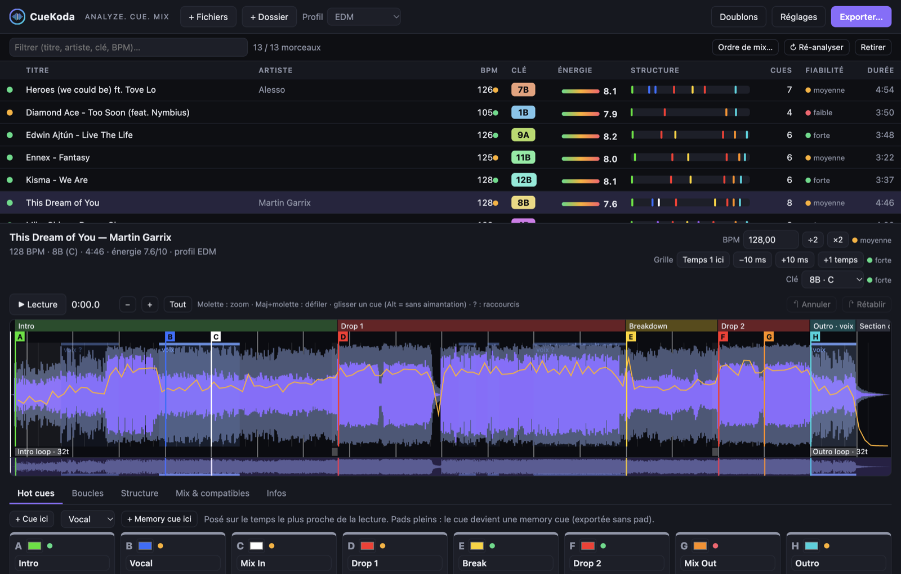
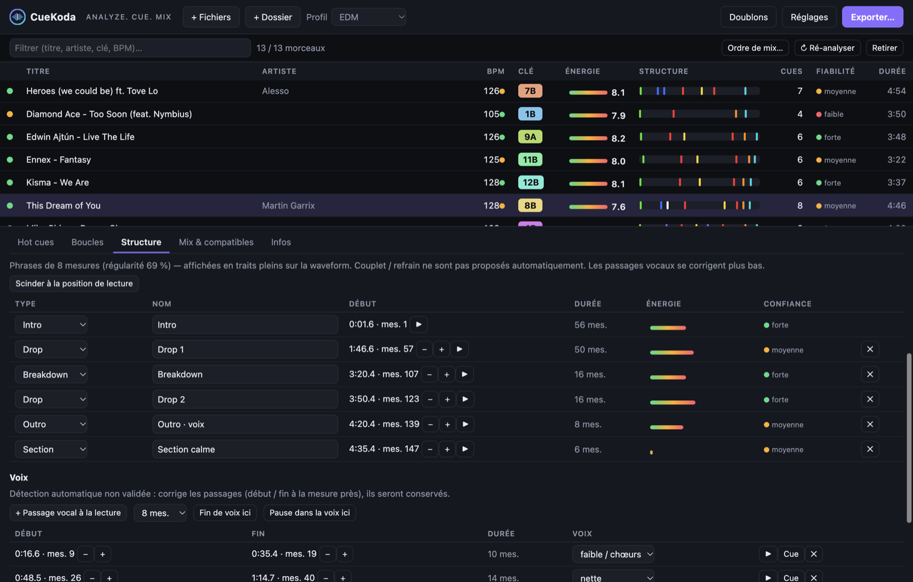
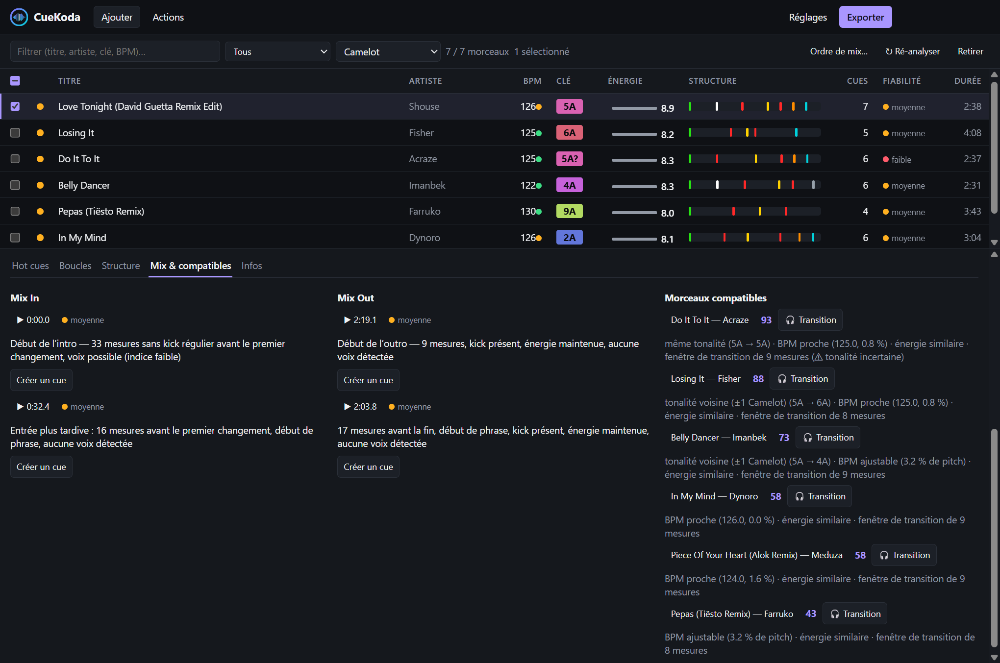
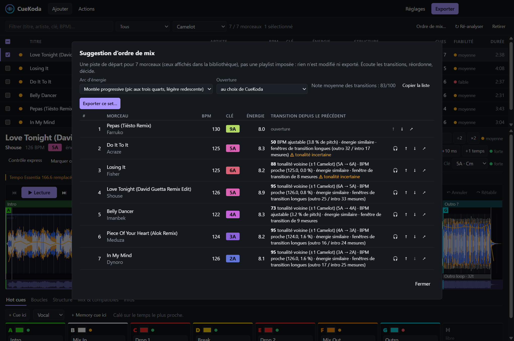
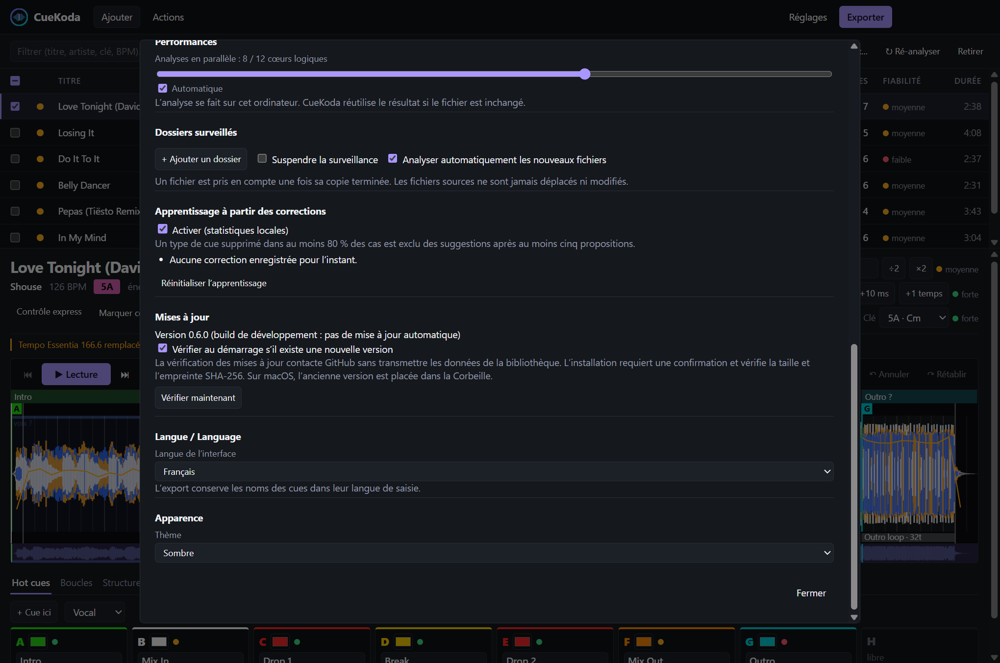

<p align="center">
  <picture>
    <source media="(prefers-color-scheme: dark)" srcset="assets/logo/png/cuekoda-logo-sombre@2x.png">
    
  </picture>
</p>

<p align="center">
  <b>La préparation de tes morceaux, faite pour toi. Les décisions restent les tiennes.</b><br>
  BPM · grille · tonalité Camelot · structure · énergie · hot cues · boucles → rekordbox, Traktor et les autres
</p>

<p align="center">
  <a href="https://github.com/Hadr1en/cuekoda/releases/latest"></a>
  
  <a href="LICENSE"></a>
  
  <a href="README.en.md"></a>
</p>

<p align="center">
  
</p>

CueKoda est une application **de préparation musicale pour DJ** (macOS et Windows). Ce n'est pas un logiciel
de mix : tu lui donnes des fichiers audio, il les analyse, et il te rend des morceaux annotés que tu importes
dans **rekordbox, Traktor, Engine DJ, VirtualDJ ou djay Pro**. Il est pensé pour l'EDM (house, big room,
progressive, techno, trance…) mais fonctionne aussi en open format.

## Sommaire
- [Principes](#principes)
- [Télécharger et installer](#télécharger-et-installer)
- [Prise en main en 4 étapes](#prise-en-main-en-4-étapes)
- [Fonctionnalités en détail](#fonctionnalités-en-détail)
  - [Analyse](#1-analyse) · [Hot cues et memory cues](#2-hot-cues-et-memory-cues) ·
    [Structure et voix](#3-structure-et-voix) · [Boucles](#4-boucles) · [Mix et transitions](#5-mix-et-transitions) ·
    [Ordre de mix](#6-suggestion-dordre-de-mix) · [Bibliothèque](#7-bibliothèque) · [Export](#8-export-vers-ton-logiciel-dj) ·
    [Réglages, mises à jour, langue](#9-réglages-mises-à-jour-et-langue)
- [Fiabilité et limites](#fiabilité-et-limites)
- [Raccourcis clavier](#raccourcis-clavier)
- [Confidentialité et sécurité](#confidentialité-et-sécurité)
- [Pour les développeurs](#pour-les-développeurs)

## Principes
- **CueKoda prépare, le DJ décide.** Chaque suggestion indique sa confiance (forte / moyenne / faible) et
  la raison pour laquelle elle a été faite. Tout est modifiable.
- **Tes corrections sont sacrées.** Un cue déplacé, renommé ou verrouillé, une section corrigée, un passage
  vocal ajusté : tout survit aux ré-analyses.
- **Rien ne sort de ta machine.** L'analyse est 100 % locale. Les fichiers audio ne sont jamais envoyés,
  modifiés, déplacés ni supprimés.
- **Pas de fausse précision.** Ce qui n'est pas vérifié est affiché comme tel : export « non vérifié »,
  détection vocale « expérimentale », tonalité « ambiguë », temps 1 « incertain ».

## Télécharger et installer
Les installeurs sont reconstruits à chaque mise à jour du code et publiés dans les
[**Releases**](https://github.com/Hadr1en/cuekoda/releases/latest).

| Système | Fichier |
|---|---|
| macOS 13+ Apple Silicon (M1 à M4) | `CueKoda-<version>-mac-arm64.dmg` |
| macOS 13+ Intel | `CueKoda-<version>-mac-x64.dmg` |
| Windows 10 / 11 64 bits | `CueKoda-<version>-windows-setup.exe` |

**Premier lancement :** l'application n'est pas encore signée par Apple ni par Microsoft.
- **macOS** : glisse CueKoda dans Applications, ouvre-le une fois, puis Réglages Système › Confidentialité
  et sécurité › **Ouvrir quand même**.
- **Windows** : à l'avertissement SmartScreen, **Informations complémentaires** › **Exécuter quand même**.

**Mises à jour** — CueKoda vérifie les releases publiques de GitHub. Tu peux aussi télécharger
l'installeur depuis les Releases et l'installer manuellement.

## Prise en main en 4 étapes
1. **Importer** : glisse des fichiers ou un dossier dans la fenêtre, ou utilise « + Fichiers » / « + Dossier ».
   Formats : MP3, WAV, AIFF, FLAC, M4A / AAC, OGG, Opus, WMA.
2. **Analyser** : l'analyse démarre seule, plusieurs morceaux en parallèle. Chaque ligne affiche l'étape et
   le pourcentage.
3. **Vérifier et corriger** : clique un morceau, écoute, déplace les cues sur la waveform, corrige BPM,
   grille ou tonalité si besoin. La colonne **Fiabilité** indique quoi vérifier en priorité.
4. **Exporter** : « Exporter… », choisis ton logiciel, enregistre le fichier, suis les étapes d'import affichées.

## Fonctionnalités en détail

### 1. Analyse


| Donnée | Ce que fait CueKoda |
|---|---|
| **BPM** | Estimation, choix demi / double tempo selon le profil (plage BPM), stabilité, confiance. Correction manuelle, ÷2 et ×2. |
| **Grille et temps 1** | Phase calée à ~2 ms près sur les attaques. Le temps 1 est voté sur les changements de section et sur les **entrées de kick / basse**. Le résultat est marqué « incertain » quand le vote est serré. Corrections : « Temps 1 ici », ±10 ms, +1 temps. |
| **Tempo variable** | Détection des changements de tempo et carte de tempo (un marqueur par plage), exportée vers rekordbox. |
| **Tonalité** | Notation musicale, **Camelot** et Open Key. L'analyse complémentaire signale les ambiguïtés et leurs alternatives. Les changements de tonalité détectés sont signalés dans Infos. |
| **Volume** | LUFS intégré, plage de loudness, true peak, RMS, crête (ffmpeg `ebur128`). |
| **Énergie** | Score 1–10 et courbe par mesure (volume normalisé par le LUFS intégré, densité d'attaques, graves, brillance). |
| **Structure** | Intro, build-up, drop, breakdown, outro, phrases de 8 / 16 / 32 mesures (seulement si elles sont régulières). Les **drops** sont repérés par palier d'énergie et placés sur l'entrée de la basse. |
| **Voix** | Détection locale expérimentale (modèle MusiCNN + heuristique) : passages vocaux nets ou faibles. |
| **Empreinte** | Empreinte chromatique par mesure, pour repérer doublons et versions d'un même morceau. |

La file d'analyse se met en pause, s'annule, relance les échecs et respecte une limite CPU. Un fichier
défectueux ne bloque jamais les autres. Un morceau déjà analysé et inchangé revient instantanément du cache.

### 2. Hot cues et memory cues
Les cues de la capture du haut sont placés d'après la musique : Intro, Vocal, Build, Drop 1, Break, Drop 2,
Mix In / Mix Out, Outro… Chacun a une **couleur par fonction** (personnalisable par profil), un **indice de
confiance** et une **raison** (« entrée de la basse : +12 dB dans les graves »).

- **Glisser** un drapeau sur la waveform pour déplacer un cue (aimanté sur le temps, Alt = libre).
- Boutons ±1 temps / ±1 mesure, renommer, changer la couleur, 🔒 verrouiller, ✕ supprimer.
- **« + Cue ici »** : ajoute un cue du type choisi (Vocal par défaut, pour la voix qui reprend) sur le
  premier pad libre. Quand les 8 pads sont pris, il devient une **memory cue**.
- **Memory cues** : cues sans pad, listées sous les pads, qu'on peut placer sur un pad à tout moment.
  Elles s'exportent en memory cues rekordbox et en cues mémorisés Traktor.
- **Cues Vocal** — Les profils intégrés excluent les suggestions Vocal. Tu peux les réactiver dans un
  profil personnalisé ou les ajouter à la main.
- **Cues superposés** — L'ajout est bloqué à une position déjà occupée. Un déplacement qui crée un doublon
  est signalé sur les pads et dans l'aperçu d'export.
- Annuler / rétablir (⌘Z / ⇧⌘Z). Les sections suivent les cues Intro / Build / Drop / Break / Outro que tu déplaces.
- **Apprentissage** : un type de cue que tu supprimes presque toujours n'est plus proposé (statistiques
  locales, réinitialisables).

### 3. Structure et voix


- **Sections** : changer le type et le nom, déplacer le début à la mesure près, scinder à la position de
  lecture, fusionner. Le bandeau coloré de la waveform se met à jour.
- **Voix** : ajouter un passage à la lecture, déplacer début et fin, « Fin de voix ici », « Pause dans la
  voix ici », choisir nette ou faible, créer un cue Vocal en un clic. Tes passages remplacent la détection
  automatique à chaque ré-analyse.

### 4. Boucles
Boucles suggérées (intro, outro, avant le drop, début de breakdown), avec longueur réglable de 4 à 64 temps,
écoute en boucle et validation. Seules les boucles validées s'exportent par défaut. Touche **L** : boucle de
16 temps à la position de lecture.

### 5. Mix et transitions


- **Mix In / Mix Out** : points d'entrée et de sortie justifiés (phrases, percussion, énergie, présence de
  voix), transformables en cue d'un clic.
- **Morceaux compatibles** : tonalité (même, voisine, relative, energy boost…), écart de BPM (demi / double
  tempo compris), énergie, longueur des fenêtres de transition. Chaque proposition est notée et expliquée,
  avec ses mises en garde (deux passages chantés qui se superposent, tonalité incertaine…).
- **🎧 Transition** : écoute la fin du morceau courant enchaînée avec le début de l'autre. Le tempo est calé
  sans changer la tonalité, les temps sont alignés au Mix Out / Mix In et le fondu dure 16 mesures. CueKoda
  refuse au-delà de ±8 % d'écart de tempo plutôt que de déformer le son.

### 6. Suggestion d'ordre de mix


Bouton discret « Ordre de mix… » au-dessus de la liste : CueKoda propose un ordre pour les morceaux affichés
(filtre d'abord pour travailler sur une sélection). Rien n'est appliqué ni exporté : c'est une piste de
départ, **construire le set reste ton travail**.

- **Arc d'énergie** : montée progressive (pic aux trois quarts puis légère redescente), vagues, ou libre
  (tonalité et tempo seulement).
- **Ouverture** : laisse CueKoda choisir ou impose ton premier morceau.
- Chaque enchaînement est **noté sur 100 et justifié**. Les enchaînements **difficiles** (clés qui
  s'opposent, écart de tempo > 8 %) sont surlignés.
- Monte / descends les morceaux, écoute chaque transition (🎧), ouvre un morceau, **copie la liste**.
- **Exporter ce set…** : la liste part dans ton logiciel DJ comme une playlist nommée, dans ton ordre.

### 7. Bibliothèque
- Liste triable et filtrable (titre, artiste, clé, BPM), avec la clé en couleur Camelot, l'énergie, une
  miniature des cues et la fiabilité.
- **Dossiers surveillés** : un fichier copié dans un dossier surveillé est analysé automatiquement, une fois
  sa copie terminée.
- **Doublons** : doublons exacts, même enregistrement dans un autre format, versions liées (remix, edit),
  grâce à l'empreinte acoustique. Rien n'est supprimé, tu décides.
- **Profils DJ** : EDM, House, Tech House, Techno, Trance, Hip-Hop, Open Format, ou tes propres profils
  (plage BPM, cues à placer, couleurs, boucles).
- **EDM — pads fixes** — Réserve les pads A à H à Intro, Build 1, Drop 1, Break, Build 2, Drop 2, Outro
  et Mix Out. Si un repère manque, son pad reste libre.
- **Révision** — Filtre « À vérifier » pour les morceaux à contrôler et « Fichiers introuvables »
  pour les chemins manquants. Marque les morceaux contrôlés à l'oreille comme vérifiés.
- **Références** : « Valider comme référence » enregistre un morceau que tu as vérifié à l'oreille. Ces
  références servent à mesurer la justesse du moteur (`npm run eval`).

Le **métronome** permet de vérifier la grille à l’oreille, avec un clic accentué sur le temps 1.
**Valider et passer au suivant** marque le morceau comme vérifié et ouvre la prochaine piste affichée.

### 8. Export vers ton logiciel DJ


Un seul bouton **« Exporter… »** : choisis ton logiciel, vois ce qui sera transféré et ce qui ne le sera
pas, enregistre le fichier, suis les étapes d'import.

| Logiciel | Fichier écrit | BPM / grille / clé | Hot cues, noms | Couleurs | Memory cues | Boucles | Import |
|---|---|---|---|---|---|---|---|
| **rekordbox** | rekordbox XML | ✓ (grille multi-tempo) | ✓ | ✓ | ✓ | ✓ | ✅ vérifié |
| **Traktor Pro** | Traktor NML | ✓ (un seul tempo) | ✓ | — (couleur par type) | ✓ (cues sans pad) | ✓ | ✅ vérifié |
| **Engine DJ** (Denon, Numark, Rane) | rekordbox XML | selon Engine DJ | selon Engine DJ | ? | ? | ? | à vérifier |
| **VirtualDJ** | rekordbox XML | selon VirtualDJ | selon VirtualDJ | ? | ? | ? | à vérifier |
| **djay Pro** | rekordbox XML | selon djay | selon djay | ? | ? | ? | à vérifier |
| **Serato DJ Pro** | — | — | — | — | — | — | indisponible |

**Options utiles** :
- **Commentaire « E8 · 8B · Vocal »** (activé par défaut) : énergie, clé Camelot et voix écrites dans le champ
  Commentaire, pour trier et filtrer ta collection directement dans ton logiciel DJ. « Vocal » ou « Instru »
  n'est écrit que si la détection est nette.
- **Exporter un set** : depuis « Ordre de mix… », « Exporter ce set… » crée une playlist nommée, avec les
  morceaux dans l'ordre que tu as arrangé.

Serato range ses cues **dans les fichiers audio eux-mêmes** : les écrire modifierait tes fichiers, ce que
CueKoda ne fait jamais. Détails et procédure de vérification : [matrice d'export](docs/MATRICE_EXPORT.md).

Dans Traktor, AutoGrid occupe le bouton 1. Les pads A–G vont sur les boutons 2–8 et le pad H devient un
cue mémorisé. AutoGrid marque le premier temps à lui seul. Valide les boucles souhaitées dans CueKoda
avant l’export avec l’option par défaut « validées uniquement ».

Pour reprendre une collection dans CueKoda, clique sur **« Importer collection… »** et choisis un XML
rekordbox ou un NML Traktor. Tes cues importés sont verrouillés. Les suggestions remplissent les pads libres.
Tu peux aussi reprendre le BPM et le premier repère de grille. Voir la [matrice d'export et d'import](docs/MATRICE_EXPORT.md).

Sécurité de l'export : CueKoda écrit un **nouveau fichier de collection**, sans jamais toucher à la base de
ton logiciel DJ (`master.db`, `collection.nml`). Un fichier existant est d'abord sauvegardé à côté.

### 9. Réglages, mises à jour et langue


- **Mises à jour** — La vérification au démarrage (désactivable) et « Vérifier maintenant » utilisent les
  releases publiques GitHub, sans transmettre de données de bibliothèque. Quand une version est disponible,
  l'installation exige ton clic, la taille attendue et une empreinte SHA-256 valide. Ce contrôle couvre
  l'intégrité du téléchargement. Voir les [décisions de distribution](docs/DISTRIBUTION.md).
  - **Windows** : installation silencieuse puis redémarrage.
  - **macOS** : l'ancienne version part à la Corbeille, la nouvelle prend sa place et redémarre.
- **Langue** : français ou anglais. Les noms de tes cues ne sont jamais traduits, ce sont tes données.
- **Thème** sombre (par défaut), clair ou système ; nombre d'analyses en parallèle ; dossiers surveillés ;
  apprentissage ; profils.

## Fiabilité et limites
CueKoda est honnête sur ce qu'il sait faire :
- Le [rapport d'évaluation](docs/EVALUATION.md) mesure les cues sur trois morceaux EDM corrigés à l'oreille.
- **À confirmer** — Nouveau mapping Traktor, décalage à l'import selon le format audio, imports Engine DJ,
  VirtualDJ et djay Pro, mise à jour sous Windows et calibration de l'énergie.
- **Expérimental** : détection vocale (des voix peuvent être manquées) ; couplet / refrain proposés
  seulement sur preuve forte.
- **Pas encore fait** : séparation de stems.
- **Tempo variable** : les marqueurs sont exportés vers rekordbox, mais cues et sections sont calculés sur
  la grille moyenne ; Traktor ne reçoit qu'un tempo.

Le détail, fonction par fonction, est dans [l'état des fonctionnalités](docs/AUDIT_ET_PLAN.md) et le
fonctionnement des algorithmes dans [ALGORITHMES.md](docs/ALGORITHMES.md).


Le sélecteur de la bibliothèque permet de passer de Camelot à Open Key (Traktor).
Par exemple, **5A** et **10m** désignent tous deux **do mineur**. La recherche accepte les deux codes.

## Raccourcis clavier
| Touche | Action |
|---|---|
| Espace | Lecture / pause |
| ← / → | Une mesure en arrière / en avant (Maj : un temps) |
| ↑ / ↓ | Morceau précédent / suivant |
| 1 … 8 | Aller au hot cue A … H |
| Maj + 1 … 8 | Poser le hot cue A … H à la lecture |
| C / M | Ajouter un cue (premier pad libre, sinon memory cue) / une memory cue |
| , / . | Déplacer le cue sélectionné d'un temps (Maj : une mesure) |
| Suppr | Supprimer le cue sélectionné |
| L | Boucle de 16 temps à la lecture |
| + / − / 0 | Zoom avant / arrière / tout le morceau |
| ⌘Z / ⇧⌘Z | Annuler / rétablir |
| ⌘E | Exporter |
| ⌘ / Ctrl + F | Filtrer la bibliothèque |
| ? | Aide |

## Confidentialité et sécurité
- Analyse locale : aucun fichier ni aucune donnée de bibliothèque n'est envoyé en ligne.
- Seule connexion réseau : la vérification des mises à jour sur GitHub (désactivable).
- Aucun fichier audio n'est jamais modifié, déplacé ni supprimé. Les doublons sont signalés, jamais effacés.
- Les exports écrivent un nouveau fichier et sauvegardent l'ancien ; la base de ton logiciel DJ n'est jamais
  modifiée directement.

## Pour les développeurs

```bash
npm install
```

```bash
npm start
```

| Commande | Rôle |
|---|---|
| `npm run test:all` | Typecheck, tests unitaires, test de bout en bout sur morceaux synthétiques |
| `npm run test:regression` | Ré-analyse `samples/` et compare à `tests/baselines/samples.json` |
| `npm run smoke` | Lance la vraie app Electron (fenêtre invisible) et pilote l'interface |
| `npm run eval` | Mesure la justesse du moteur sur tes morceaux validés comme références |
| `npm run eval:dj` | Évalue les corrections DJ sur trois morceaux fournis localement dans `samples/` |
| `npm run offset-test` | Génère des pistes de clics et des collections XML/NML pour mesurer les décalages à l'import |
| `npm run dist:mac` / `dist:win` | Construit les installeurs en local |

La ligne de commande utilise le même moteur :

```bash
npm run build && node dist/cli/cli.js ~/Music/MonDossier --profile house --out sortie
```

**Architecture**
```
src/core/       moteur pur : décodage, tempo, grille, tonalité, énergie, structure, cues, boucles, mix,
                profils, fusion, matching, ordre de mix, transitions, doublons, apprentissage, export/
src/main/       Electron : bibliothèque persistante, cache, file d'analyse (workers), dossiers surveillés,
                mises à jour
src/renderer/   interface (bibliothèque, vue d'analyse, dialogues) : HTML / CSS / TypeScript sans framework
src/shared/     types IPC, logique de mise à jour, traduction
src/test/       unitaires, bout en bout, non-régression, diagnostics
```

**Stack et licences tierces** : Electron 45, TypeScript, esbuild, electron-builder ; Essentia.js
(AGPL-3.0), ffmpeg-static (binaire GPL), music-metadata, TensorFlow.js (Apache-2.0) et le modèle
`voice_instrumental-musicnn-msd-2` du Music Technology Group (UPF). Voir la [licence](#licence).

**Documentation** : [guide utilisateur](docs/GUIDE_UTILISATEUR.md) · [algorithmes et limites](docs/ALGORITHMES.md) ·
[matrice d'export](docs/MATRICE_EXPORT.md) · [audit et état des fonctionnalités](docs/AUDIT_ET_PLAN.md)

## Licence
CueKoda est un logiciel libre sous **GNU AGPL v3 ou ultérieure** ([LICENSE](LICENSE)) : tu peux l'utiliser,
l'étudier, le modifier et le redistribuer, à condition de publier aussi le code source de tes versions
modifiées, y compris quand elles sont proposées comme service en ligne. Copyright © 2026 Hadr1en.

Composants tiers, chacun sous sa propre licence : Essentia.js (AGPL-3.0), ffmpeg-static (binaire GPL),
TensorFlow.js (Apache-2.0), music-metadata (MIT) et Electron (MIT). Le modèle vocal `voice_instrumental-musicnn-msd-2` du
Music Technology Group (UPF) est soumis à des conditions propres, dont une clause non commerciale.
Voir [la note sur la licence du modèle](docs/DISTRIBUTION.md#décisions-avant-diffusion).

## Logo
L'anneau de la *coda* (« Koda ») contient une waveform dont la barre centrale blanche marque le point de cue.
Sources dans [assets/logo](assets/logo).
